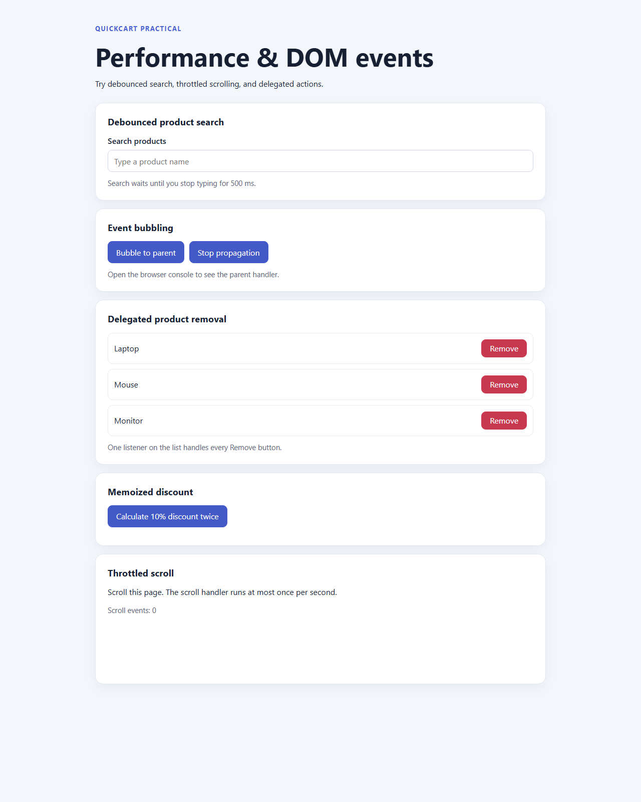

# Advanced JavaScript Practical Assignment

QuickCart is a small, dependency-free set of practical exercises for modern JavaScript. The examples cover prototypes and classes, array and collection methods, JSON behavior, asynchronous order processing, browser performance techniques, DOM events, and an integrated order summary.

## Technologies

- JavaScript (ES6+)
- Node.js for Parts A–D and Part F
- HTML, CSS, and browser JavaScript for Part E
- No external libraries or frameworks

## How to run

Run each Node.js exercise from the project root:

```sh
node part-a-objects-classes/products.js
node part-b-array-methods/shopping-cart.js
node part-c-json-debugging/json-handling.js
node part-d-asynchronous/order-processing.js
node part-f-integration/quickcart.js
```

Open `part-e-optimization-events/index.html` in a browser. Use the browser console to observe event bubbling and the memoization cache messages.

## Parts

### Part A — Objects, prototypes, and classes

`part-a-objects-classes/products.js` demonstrates a constructor with a shared prototype method, an ES6 class hierarchy, and arrow functions, template literals, destructuring, rest parameters, and spread syntax.

- A prototype method is shared by instances rather than recreated on every instance.
- `prototype` is the object used for instances created by a constructor; `__proto__` is the legacy accessor for an object's internal prototype link. Prefer `Object.getPrototypeOf()`.
- If a property is missing on an object, JavaScript searches its prototype chain; if no object supplies it, the result is `undefined`.
- `extends` establishes class inheritance. A derived constructor must call `super()` before accessing `this`; classes use JavaScript's prototype-based inheritance underneath.
- Arrow functions do not have their own `this`. Template literals interpolate expressions. Destructuring extracts object properties; rest gathers remaining arguments; spread expands iterable/object values into a new copy.

### Part B — Array methods, Map, Set, and object integrity

`part-b-array-methods/shopping-cart.js` maps cart items to line totals, filters products by unit price, reduces the cart to totals, logs with `forEach`, and calculates the Electronics subtotal. It also demonstrates inventory updates with `Map`, email deduplication with `Set`, and mutation behavior of frozen and sealed objects.

- `map()` returns a transformed array; `forEach()` is for side effects and returns no useful array. `filter()` returns a new array without changing the source. `reduce()` accumulates values such as totals.
- `Map` supports keys of any type, preserves insertion order, and exposes size and iteration APIs. A plain object coerces property keys to strings or symbols. `Set` stores unique values and preserves insertion order.
- `Object.freeze()` prevents adding, removing, or changing own properties; `Object.seal()` prevents adding or removing properties, but existing writable properties may change. These operations are shallow: nested objects are not frozen automatically.

### Part C — JSON handling and output prediction

`part-c-json-debugging/json-handling.js` serializes and parses an order, records omitted properties, and safely demonstrates invalid JSON and circular-reference errors.

- In objects, `undefined` values and functions are omitted; in arrays, `undefined` becomes `null`. `NaN` and infinities serialize as `null`. JSON requires quoted property names and double-quoted strings. Circular references cause `JSON.stringify()` to throw. A `Date` serializes through `toJSON()` as an ISO timestamp.
- The order's `deliveryDate` and `calculateTax` do not survive JSON serialization: `undefined` object values and function-valued properties are omitted. `discount: null` remains.

### Part D — Asynchronous JavaScript

`part-d-asynchronous/order-processing.js` predicts event-loop ordering, runs callback and promise chains, demonstrates async/await success and failure handling, and exercises all four Promise combinators.

- Promise callbacks are microtasks and run after the current stack empties but before timer callbacks (tasks/macrotasks). The event loop coordinates the call stack and queued work.
- Nested callbacks are hard to read and maintain because control flow, errors, and shared state become deeply nested (“callback hell”).
- `Promise.all()` rejects as soon as one input rejects; `Promise.allSettled()` waits for every outcome. `Promise.race()` settles with the first outcome, whether fulfillment or rejection. `Promise.any()` fulfills with the first fulfillment and rejects with an `AggregateError` only if all inputs reject.

### Part E — Performance optimization and DOM events

`part-e-optimization-events/` contains an interactive browser demo: search is debounced by 500 ms, scrolling is throttled to once per second, discount calculations are memoized, and product removal uses event delegation.

- Debouncing waits for a quiet interval and suits search suggestions; throttling limits frequency and suits scroll/resize handlers.
- Memoization caches results for repeated arguments. The closure retains the cache between calls.
- Bubbling propagates an event from its target toward ancestors; `stopPropagation()` halts that propagation. Delegation uses a parent listener to handle child events, including dynamically added children.
- `event.target` is the originating element; `event.currentTarget` is the element whose listener is currently running.

### Part F — Integrated QuickCart order

`part-f-integration/quickcart.js` builds Rahul's order with a `Product` class; it uses destructuring, `map`, `filter`, `reduce`, `Set`, `Map`, `Object.freeze`, JSON serialization, async/await, try/catch, and a template literal for confirmation.

The expected computed order total is ₹69,000, with four unique products.

## DOM demo screenshot

Open `part-e-optimization-events/index.html` in a browser to view and interact with the DOM features.


